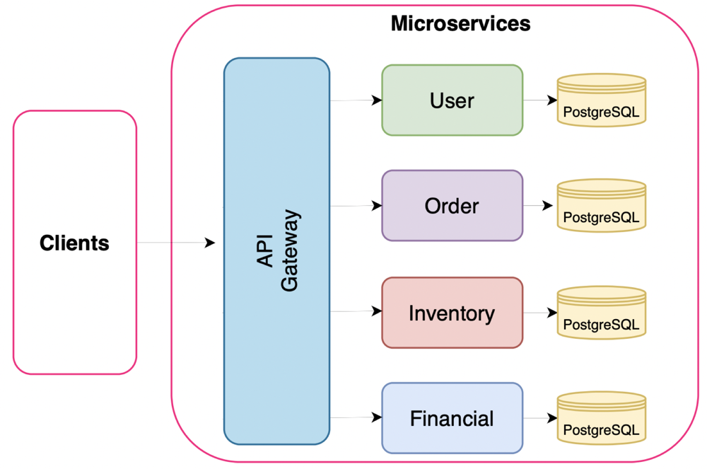

# Cloud-Native E-Commerce Platform: Microservices on Kubernetes vs. Serverless

A microservice-based e-commerce backend built with **Django** and **PostgreSQL**, deployed two ways on **Google Cloud**: as containers on **Kubernetes (GKE)** and as **serverless functions** on Google Cloud Functions. The two deployments were then load-tested and compared on response time and CPU usage.

**Stack:** Python, Django, Django REST Framework, Flask, PostgreSQL, Docker, Kubernetes (GKE), Helm, Google Cloud Functions, Cloud SQL, Cloud API Gateway, Locust

*Team project for Distributed and Cloud Systems at Simon Fraser University (2023).*

## Architecture



The platform has four microservices, each with its own PostgreSQL database:

| Service | Responsibility |
|---|---|
| **User** | User management and authentication |
| **Order** | Customer orders and shopping carts |
| **Inventory** | Products, prices and stock levels |
| **Financial** | Accounts, payments and invoices |

Services communicate through synchronous REST calls. Two flows span several services:

- **Add to cart:** Order authenticates the user with User, then checks availability and price with Inventory.
- **Checkout:** Order authenticates the user with User, then sends a payment request to Financial.

## Deployments

### Serverful: Kubernetes on GKE

- Each service is containerized with Docker and deployed to **Google Kubernetes Engine** with its own deployment manifest
- Services are exposed internally through **ClusterIP** services and connect to a **PostgreSQL StatefulSet** through a headless service
- An **API Gateway** integrated with Kubernetes **ingress** gives external clients a single entry point
- A **Helm chart** generates and deploys all manifests from one values file, replacing manual per-service redeploys
- **GCP managed monitoring** with custom dashboards tracks performance metrics for each service

### Serverless: Google Cloud Functions

- The APIs are reimplemented as lightweight **Flask** functions on **Google Cloud Functions** (running on Cloud Run), without Django
- Each service keeps its own **Cloud SQL** PostgreSQL database, preserving the microservice boundaries
- **Google Cloud API Gateway** routes requests to and between the functions

## Results

We load-tested both deployments with **Locust** using an end-to-end scenario that touches every service: create a user, list products, add to cart and check out. The test ramped up to **100 concurrent users** at 1 new user per second.

- **Response time:** in the Kubernetes deployment, response time grew as the number of users increased. In the serverless deployment it stayed flat thanks to automatic scaling, apart from an initial **cold start**.
- **Bottleneck:** monitoring showed the **User** service's CPU hitting its limit under load while Financial and Inventory stayed underused. The User service became the bottleneck for the whole system.
- **Takeaway:** fixing this on Kubernetes requires manual tuning and redeployment, while the serverless version scales each API independently.

The full write-up with charts is in the [project report](Report.pdf).

## Repository Structure

```
├── users-main/        # User service (Django + DRF)
├── order-main/        # Order service (Django + DRF)
├── products-main/     # Inventory service (Django + DRF)
├── financial-main/    # Financial service: accounts and invoices (Django + DRF)
├── serverless-main/   # Serverless functions (Flask on Google Cloud Functions)
└── Report.pdf         # Project report
```

Each Django service includes a `Dockerfile` and a `docker-compose.yml` that starts the service with its own PostgreSQL container.

## Running a Service Locally

Each service runs independently with Docker Compose. The services share an external Docker network named `ds`:

```bash
docker network create ds
cd users-main
docker compose up --build
```

Repeat for the other services. Each one is exposed on its own port:

| Service | Port |
|---|---|
| Order | 8000 |
| Financial | 8001 |
| Inventory | 8002 |
| User | 8003 |
